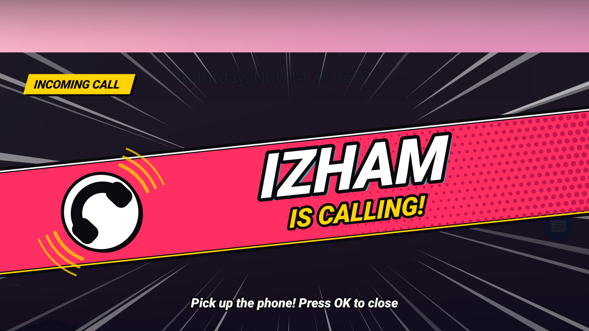

# TV Call Alert

**Version 0.1.0**

When you call home and nobody hears the phone, tap one button and the family TV pauses the
show and plays an anime-style "YOU are calling" card, like an ad break, until someone
presses OK and picks up the phone.



```
Your iPhone                 Free relay (ntfy.sh)          TV at home
[ Call home ]  -- signed --> [ private channel ]  ---->   pause show, show the card
status line    <-- signed -- [ private channel ]  <----   "shown" / "they pressed OK"
then place the WhatsApp call as usual
```

It is an alert only. The call itself still happens on WhatsApp on the phones.

## Tech stack

| Part | Stack |
|---|---|
| TV app (`app/`) | Android (Java 8, minSdk 26, targetSdk 30), no libraries |
| Logic (`core/`) | pure Java 8, JUnit 4 |
| Phone page (`trigger/`) | static HTML, CSS and ES modules, WebCrypto, no dependencies |
| Relay | ntfy.sh public pub/sub over HTTPS, HMAC-SHA256 signed messages |
| Build | Gradle 6.1.1, Android Gradle Plugin 4.0.2, JDK 8 |

Design: [docs/ARCHITECTURE.md](docs/ARCHITECTURE.md), [docs/PROTOCOL.md](docs/PROTOCOL.md),
[docs/STANDARDS.md](docs/STANDARDS.md).

## Build and test

PowerShell, from this folder:

```powershell
$env:JAVA_HOME='C:\Program Files\Android\Android Studio\jre'; $env:ANDROID_SDK_ROOT="$env:LOCALAPPDATA\Android\Sdk"; $env:ANDROID_HOME=$env:ANDROID_SDK_ROOT
```

```powershell
.\gradlew.bat :core:test
```

```powershell
node --test trigger/test/
```

```powershell
.\gradlew.bat :app:assembleDebug
```

The debug APK lands in `app\build\outputs\apk\debug\app-debug.apk`.

For the copy that goes on the real TV, create a signing key once (see
`keystore.properties.example`), then run `.\gradlew.bat :app:assembleRelease`. Keep that key
backed up: the TV only accepts updates signed with the same key.

## Install on the TV (once, in person)

You need a laptop on the same Wi-Fi as the TV. `adb` is in
`%LOCALAPPDATA%\Android\Sdk\platform-tools`. Replace `PKG` with `dev.tvcallalert` (release
build) or `dev.tvcallalert.debug` (debug build).

1. On the TV: Settings, System, About. Press "Android TV OS build" seven times, then turn on
   USB debugging (or wireless debugging) in Developer options.
2. `adb connect <tv-ip>:5555` and accept the prompt on the TV.
3. `adb install -r app-release.apk`
4. Arm both ways of drawing the card:
   - `adb shell appops set PKG SYSTEM_ALERT_WINDOW allow`
   - On the TV: Settings, System, Accessibility, turn on "TV Call Alert card".
     If it is missing or greyed out:
     `adb shell appops set PKG ACCESS_RESTRICTED_SETTINGS allow`, then
     `adb shell settings put secure enabled_accessibility_services PKG/dev.tvcallalert.AlertA11yService`
     and `adb shell settings put secure accessibility_enabled 1`.
     That `settings put` replaces the list, so check
     `adb shell settings get secure enabled_accessibility_services` first and keep anything
     already in it, separated by `:`.
5. Open "TV Call Alert" on the TV. Both status lines should turn green once a phone is paired.
6. Press OK on "Phone 1", type the name the card should show, and note the pairing code.
7. Press "Show a test call" while a show is playing. Try it over YouTube, Netflix, live TV
   and HDMI.
8. Restart the TV, then put it in standby and wake it, and test again each time.
9. Turn debugging off again.

## Set up the iPhone

1. Open the Call Home page in Safari and use Share, Add to Home Screen.
2. Open it from the home screen (not from Safari: they have separate storage).
3. Type the pairing code from the TV and press Pair. Keep the code somewhere safe, such as
   a password manager, so you can pair again without being at the TV.
4. Tap "Call home". The page shows what the TV did.

## Optional: your picture on the card

Copy an image named `portrait.png` or `portrait.jpg` to the app's folder on the TV and the
card shows it in the circle instead of the phone icon:

```
adb push portrait.png /sdcard/Android/data/PKG/files/portrait.png
```

## What it cannot do

- It cannot detect the WhatsApp call by itself. You tap the button, then you call.
- Live TV and HDMI inputs cannot be paused. The card still covers the picture.
- If the TV is off or in standby, no card is shown. The page tells you.
- It has not yet been tested on the real TCL TV. See "Known limits" in the architecture doc.

## Developer tools

- `node tools/gen-vectors.mjs` regenerates the shared test vectors.
- `tools/send-test.mjs` sends a signed `alert`, `ping` or `cancel` and prints the acks. It
  reads the pairing string from the `TVCA_PAIRING` environment variable.
